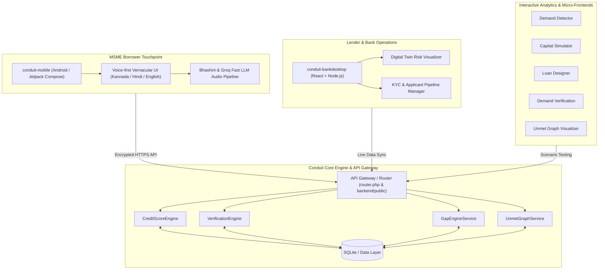
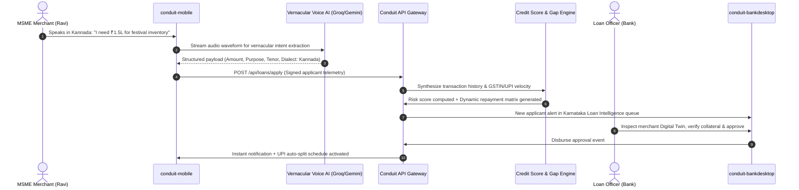
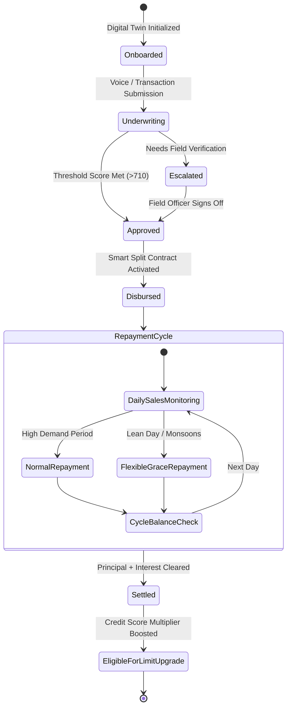

# Conduit: Next-Gen Autonomous Credit & Capital Engine for MSMEs

> An intelligent, multi-surface credit infrastructure bridging underserved micro-enterprises with formal financial institutions using real-time operational signals, vernacular AI, and automated risk synthesis.

---

## Architecture Overview

Conduit connects small businesses (MSMEs) to lenders through a three-tier architecture:
1. **Borrower Touchpoint (`conduit-mobile`)**: Native Android app powered by Vernacular Voice AI (Groq & Gemini) in local languages (Kannada & Hindi) for seamless voice-first credit applications.
2. **Lender Operations (`conduit-bankdesktop`)**: Enterprise loan intelligence portal for credit officers and field agents to evaluate, monitor, and underwrite applicants.
3. **Core Intelligence Services (`backend` & `apps`)**: Autonomous engines for cash flow analysis, supply chain graph mapping, and real-time verification.



---

## System Workflows

### 1. Vernacular Loan Onboarding to Underwriting Flow



### 2. Micro-Installment Dynamic Repayment Lifecycle



---

## Repository Structure

```
conduit-coderX/
├── conduit-mobile/          # Native Android app (Jetpack Compose, Kotlin, Vernacular AI)
├── conduit-bankdesktop/     # Loan officer desktop & web console (React 19, Tailwind, Node.js)
├── backend/                 # Core credit & risk scoring engine (PHP 8+, SQLite)
│   ├── src/                 # CreditScoreEngine, VerificationEngine, OpportunityService
│   ├── database/            # SQLite schema, seed data, and migration files
│   └── public/              # HTTP entrypoint & JSON API endpoints
├── apps/                    # Embedded micro-frontends & financial simulation tools
│   ├── capital-simulator/   # Cash flow stress tester & liquidity projections
│   ├── demand-detector/     # Regional inventory & consumer demand radar
│   ├── demand-verification/ # Bill and invoice authenticity inspector
│   ├── gap-engine/          # Unmet capital allocation visualizer
│   ├── loan-designer/       # Dynamic micro-EMI term customizer
│   ├── msme-app/            # Lightweight mobile web preview
│   └── unmet-graph/         # Supply-chain dependency and credit link graph
├── sequence/                # Step-by-step visual presentation asset frames
├── index.html               # Central ecosystem overview and launchpad
└── router.php               # Local development server and cross-origin gateway
```

---

## Module Directory & Quick Links

- **[conduit-mobile README](conduit-mobile/README.md)**: Android setup, Gradle builds, Vernacular AI integration, and audio permissions.
- **[conduit-bankdesktop README](conduit-bankdesktop/README.md)**: Bank officer portal, local SQLite configuration, CSV import/export, and React setup.

---

## Local Development & Running the Stack

### 1. Run Core Backend & Micro-Frontends

```powershell
# In project root:
php -S 127.0.0.1:8000 router.php
```
Open **http://127.0.0.1:8000** in your browser to access the central launchpad, simulated engines, and interactive visualizers.

### 2. Run Bank Desktop App (`conduit-bankdesktop`)

```powershell
cd conduit-bankdesktop
npm install
npm start
```
Starts the bilingual loan intelligence workstation at **http://127.0.0.1:4173**.

### 3. Run Android Mobile App (`conduit-mobile`)

Open `conduit-mobile` in **Android Studio**:
1. Copy `.env.example` to `.env` and configure your API keys.
2. Select your Android emulator or physical device.
3. Build and launch with `gradlew build` or directly in Android Studio.
