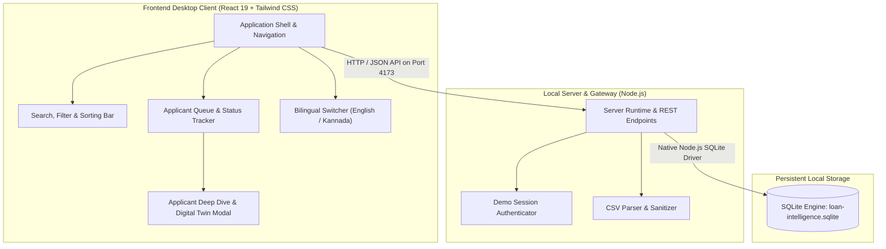
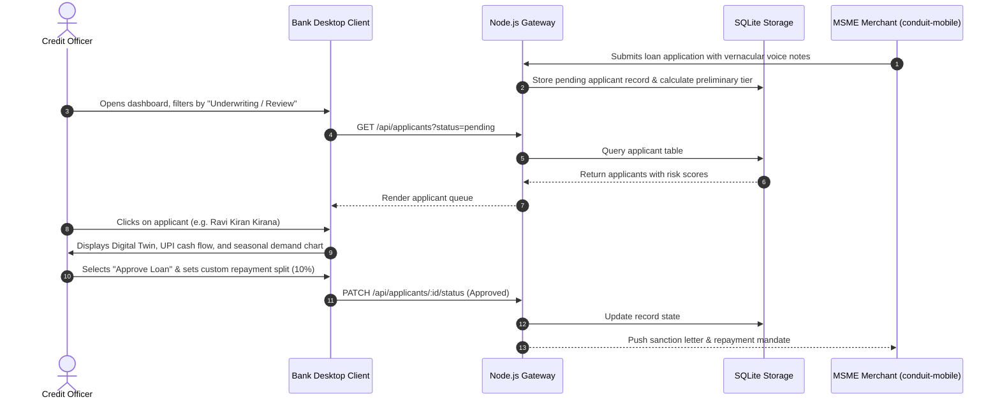

# Karnataka Loan Intelligence (Conduit Bank Desktop)

> High-fidelity, bilingual workstation built for bank credit officers, loan underwriters, and field inspectors in Karnataka to manage applicants, inspect financial digital twins, and monitor micro-installment performance.

---

## Key Capabilities

- **Bilingual Interface**: Full native support for English and Kannada with instant on-the-fly toggling.
- **Applicant Pipeline & Search**: Filter applicants by risk score, disbursement status, district, and loan size.
- **Digital Twin Inspection**: View live synthetic balance sheets, daily UPI sales velocity, and seasonal peak forecasts.
- **Data Integrity & Export**: Fast CSV import/export with phone number preservation and local SQLite storage.

---

## Desktop System Architecture



---

## Underwriting & Inspection Lifecycle



---

## Directory Organization

```
conduit-bankdesktop/
├── src/
│   ├── components/        # Table, forms, modal dialogs, and navigation
│   ├── locales/           # English and Kannada translation bundles
│   ├── App.jsx            # Main view composition & state
│   └── main.jsx           # React mounting
├── server/
│   ├── index.js           # Express API server & SQLite connection
│   └── seed.js            # Initial applicant data seeder
├── data/
│   └── loan-intelligence.sqlite # Local applicant database
├── outputs/               # Standalone production distribution builds
├── package.json           # Dependencies (React 19, Vite, Tailwind)
└── vite.config.js         # Build tooling configuration
```

---

## Quick Start & Running Locally

### Prerequisites
- **Node.js 20 or 24**
- **npm** (bundled with Node.js)

### Installation & Launch

```powershell
# Navigate to the bank desktop directory
cd conduit-bankdesktop

# Install dependencies
npm install

# Build client and run the local server
npm start
```

The application will start at **http://127.0.0.1:4173**.

### Demo Credentials
- **Email**: `demo@kli.in`
- **Password**: `KarnatakaDemo26`

### Building for Production / Standalone
```powershell
npm run build
```
Compiled output is saved to `dist/` and a standalone bundle is generated at `outputs/karnataka-loan-intelligence.html`.
