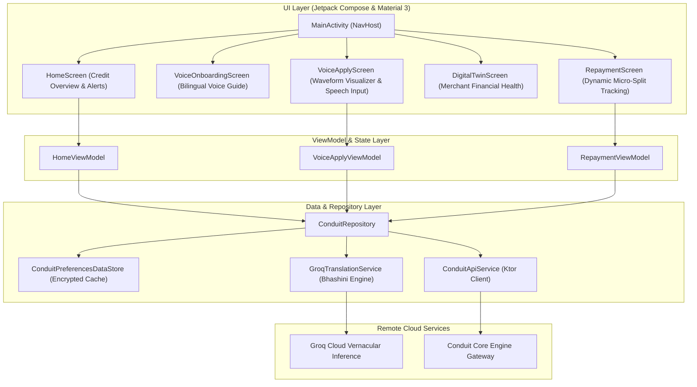
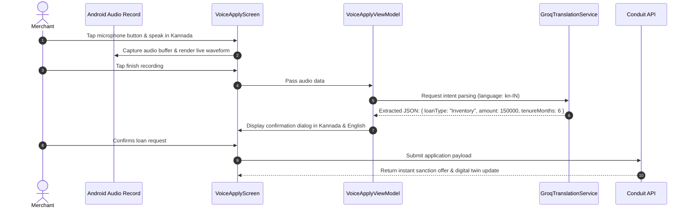

# Conduit Mobile: Vernacular Voice-First MSME Banking

> Native Android application crafted with Jetpack Compose, Material 3, and integrated with Bhashini / Groq LLMs to deliver real-time voice credit applications, financial digital twins, and flexible daily repayment schedules for Indian micro-merchants.

---

## Architectural Highlights

- **Voice-First Interaction**: Allows non-English speaking merchants to speak in Kannada, Hindi, or English to apply for working capital.
- **Real-Time Vernacular Translation**: Fast audio inference powered by Groq and Gemini models to extract loan requirements, sales velocity, and inventory needs.
- **Financial Digital Twin**: Visualizes the merchant's live operational health, creditworthiness, and revenue trends on-device.
- **Dynamic Cash Flow Repayments**: Micro-installments tailored to daily UPI receipts rather than rigid monthly EMIs.

---

## Component Architecture



---

## Voice Application Execution Flow



---

## Folder Organization

```
conduit-mobile/
├── app/
│   ├── build.gradle.kts           # Compose dependencies, Ktor, and compiler flags
│   └── src/
│       ├── main/
│       │   ├── AndroidManifest.xml # Permissions (Microphone, Internet, Audio)
│       │   ├── java/com/conduit/msme/
│       │   │   ├── ConduitApp.kt  # Application entrypoint
│       │   │   ├── data/          # ApiClient, GroqTranslationService, Models, DataStore
│       │   │   └── ui/            # Compose screens, ViewModels, Themes, and Components
│       │   └── res/
│       │       ├── values/        # Default English strings, colors, themes
│       │       ├── values-kn/     # Kannada vernacular translation strings
│       │       ├── font/          # Noto Sans Kannada & Inter fonts
│       │       └── drawable/      # Adaptive icons, logos, and merchant profile assets
│       └── test/                  # Unit and Robolectric tests
├── gradle/
│   └── libs.versions.toml         # Gradle Version Catalog
└── build.gradle.kts               # Root Android build configuration
```

---

## Setup & Running Locally

### Prerequisites
- **Android Studio Ladybug (or newer)**
- **JDK 17 or higher**
- Android SDK with API 34+

### Step-by-Step Instructions

1. **Clone and open the directory**:
   Open Android Studio, choose **Open**, and navigate to `conduit-mobile`.

2. **Configure Environment Variables**:
   Copy the example environment template:
   ```bash
   cp .env.example .env
   ```
   Add your keys in `.env`:
   ```properties
   GROQ_API_KEY=your_groq_api_key_here
   GEMINI_API_KEY=your_gemini_api_key_here
   ```

3. **Build the Project**:
   ```powershell
   ./gradlew assembleDebug
   ```

4. **Run on Device or Emulator**:
   Select your connected device in Android Studio and press **Run (Shift + F10)**.
